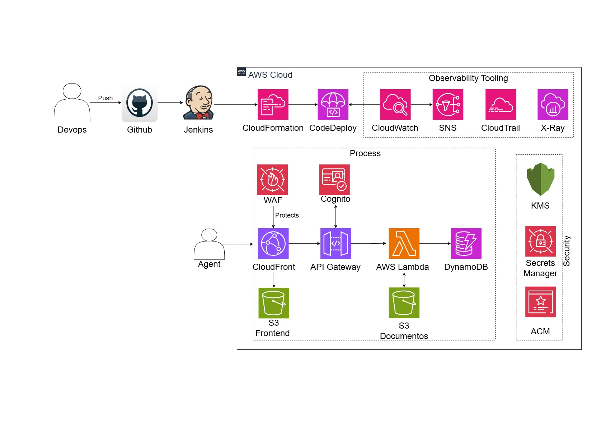

# Caso Práctico — Ingeniero DevOps (Aseguradora Colombiana | Cumplimiento SFC)

Solución integral **End-to-End** para la aplicación serverless de **registro de siniestros vehiculares en terreno**, implementada en **AWS (`us-east-1`)** bajo los lineamientos de ciberseguridad y nube de la **Superintendencia Financiera de Colombia (SFC — Circular Externa 007 de 2018 y Circular Externa 005 de 2019)** y la **Ley 1581 de 2012 (Habeas Data)**.

---

## 1. Arquitectura Implementada (Flujo de Componentes en AWS)



| Capa | Componente AWS (`infra/template.yaml`) | Función Principal | Conexión Siguiente |
|---|---|---|---|
| **1. Entrada y Perímetro** | **AWS WAFv2 (`FrontendWebACL`) + Amazon CloudFront (`CloudFrontDistribution`)** | Filtra ataques OWASP en `prod`, fuerza HTTPS (`TLS 1.2+`) y sirve el portal con firma **OAC (`SigV4`)**. | `/*` → Bucket S3 Frontend<br>`/api/v1/*` → API Gateway |
| **2. Frontend Estático** | **Amazon S3 (`FrontendBucket`)** | Aloja el SPA de registro de siniestros 100% privado (`PublicAccessBlockConfiguration: true`). | Consume los endpoints REST del API Gateway |
| **3. API y Autenticación** | **Amazon API Gateway (`SiniestrosApi`) + Amazon Cognito (`AgentsUserPool`)** | Autentica a los agentes de seguros, habilita trazabilidad **AWS X-Ray** y enruta las peticiones REST. | Invoca el alias `:live` de las 2 funciones Lambda |
| **4. Cómputo y Canary** | **AWS Lambda (`ClaimsFunction` y `DocumentsFunction`) + AWS CodeDeploy** | Runtime `nodejs22.x` (`arm64`) con `LogFormat: JSON`, alias `:live` y despliegue gradual **`Canary10Percent5Minutes`** con Auto-Rollback `< 1 min`. | Lee/escribe en DynamoDB, S3 Reports y Secrets Manager |
| **5. Datos y Cifrado SFC** | **DynamoDB (`ClaimsTable`) + S3 (`ReportsBucket`) + Secrets Manager + KMS (`AppKmsKey`)** | Cifrado en reposo con llave **KMS CMK** (rotación anual automática), **PITR (35 días)** en DynamoDB y URLs prefirmadas (5 min) en S3. | Protegido bajo normativa SFC (CE 007/2018 y Ley 1581) |
| **6. Observabilidad e IA** | **CloudWatch (`DataProtectionPolicy` + 3 Alarmas + Dashboard DORA) + SNS (`AlertsTopic` / `ChatOpsSummaryTopic`) + Lambda `IncidentAiFunction` + Amazon Bedrock** | Enmascara PII en logs (`*****`), dispara alertas a **SNS** + Auto-Rollback en CodeDeploy, ejecuta ChatOps RCA en tiempo real con **Bedrock** y grafica métricas DORA. | Cierra el ciclo de monitoreo, autodiagnóstico y mejora continua |

---

## 2. Estructura Limpia del Repositorio

```text
Prueba_tecnica/
├── README.md                        # Guía general, arquitectura y comandos rápidos
├── Jenkinsfile                      # Pipeline CI/CD declarativo con las 8 etapas
├── .security-exceptions.yaml        # Política de Quality Gates (Bloqueo vs Advertencia) y excepciones
├── ci/
│   └── jenkins/Dockerfile           # Imagen Docker del runner inmutable con herramientas preinstaladas
├── infra/
│   ├── template.yaml                # Único template SAM autónomo (100% de la arquitectura)
│   ├── samconfig.toml               # Configuración de despliegue por ambiente (dev, staging, prod)
│   └── params/                      # Parámetros por ambiente validados con JSON Schema
│       ├── dev.json
│       ├── staging.json
│       ├── prod.json
│       └── schema.json
├── backend/
│   ├── package.json                 # Scripts de lint y pruebas unitarias nativas (node --test)
│   ├── claims/index.mjs             # Lambda claims: POST, GET, PATCH + maskPii() + Secrets Manager
│   ├── documents/index.mjs          # Lambda documents: genera PDF en S3 cifrado con KMS + URL 5 min
│   ├── incident-ai/index.mjs        # Lambda ChatOps (Caso IA #3): Alarma SNS -> Logs -> Bedrock -> SNS RCA
│   └── tests/backend.test.mjs       # Pruebas unitarias rápidas de validación, PII y ChatOps IA
├── frontend/
│   ├── index.html                   # Portal SPA ligero conectado a /api/v1/claims y /documents/report
│   └── package.json                 # Empaquetado en frontend/dist/ para sincronizar con S3
├── scripts/
│   ├── validate-params.sh           # Valida dev.json, staging.json y prod.json contra schema.json
│   ├── deploy-frontend.sh           # Sincroniza SPA a S3 e invalida caché en CloudFront
│   ├── smoke-test.sh                # Pruebas E2E automatizadas contra los 4 endpoints del API Gateway
│   ├── dora-metrics.sh              # Publica las 4 métricas DORA en CloudWatch (SiniestrosDORA)
│   ├── ai-devops-assistant.sh       # Integración con Amazon Bedrock (Triage DevSecOps y RCA de fallos)
│   └── teardown.sh                  # Limpieza completa de buckets y stacks para costo $0
└── docs/                            # Respuestas detalladas a cada entregable del PDF y archivo .drawio
```

---

## 3. Resolución de los 7 Problemas Actuales del Caso

| # | Problema Inicial | Solución Implementada |
|---|---|---|
| 1 | **Despliegue manual** desde máquinas locales | Pipeline declarativo en [`Jenkinsfile`](Jenkinsfile) y despliegue automatizado con `sam deploy --config-env <env>` con auto-remediación de fallos previos. |
| 2 | **Sin pipeline CI/CD** ni validaciones previas | Flujo completo: `Checkout → Validate Config & IaC → Build & Unit Tests → Security Scan en paralelo + AI Triage → Deploy + Smoke E2E`. |
| 3 | **Sin análisis de seguridad** (SAST, SCA, IaC) | **Gitleaks** (secretos), **Semgrep** (SAST), **npm audit** (SCA), **sam validate** y **Checkov** (IaC con `--hard-fail-on`) con política en [`.security-exceptions.yaml`](.security-exceptions.yaml). |
| 4 | **Sin observabilidad** ni trazabilidad | Logs JSON estructurados con enmascaramiento de PII, trazabilidad **AWS X-Ray**, **CloudWatch Dashboard** y **3 alarmas críticas** conectadas a **SNS**. |
| 5 | **Configuración inconsistente** entre ambientes | Un único template [`infra/template.yaml`](infra/template.yaml) + archivos [`infra/params/*.json`](infra/params/) validados contra [`schema.json`](infra/params/schema.json) antes de desplegar. |
| 6 | **Sin estrategia de rollback** (>1 hora manual) | **AWS CodeDeploy Canary** (`Canary10Percent5Minutes` en `prod`) + rollback automático disparado por alarmas de CloudWatch en **< 1 minuto**. |
| 7 | **Datos sensibles (PII) y regulación SFC** | Función [`maskPii()`](backend/claims/index.mjs), política `DataProtectionPolicy` en CloudWatch, cifrado **KMS CMK** con rotación anual en DynamoDB, S3, Secrets Manager, Lambdas, CloudWatch Logs y SNS. |

---

## 4. Documentación Detallada por Entregable (Preguntas del PDF)

1. **[Pipeline CI/CD y Estrategia de Despliegue (`docs/01-pipeline-y-despliegue.md`)](docs/01-pipeline-y-despliegue.md)**
2. **[IaC, Consistencia de Ambientes y Gestión de Secretos (`docs/02-iac-ambientes-y-secretos.md`)](docs/02-iac-ambientes-y-secretos.md)**
3. **[Seguridad Integrada (DevSecOps) y Cumplimiento SFC (`docs/03-seguridad-devsecops-y-sfc.md`)](docs/03-seguridad-devsecops-y-sfc.md)**
4. **[Observabilidad, Alertas Críticas y Métricas DORA (`docs/04-observabilidad-y-dora.md`)](docs/04-observabilidad-y-dora.md)**
5. **[Integración de Inteligencia Artificial en DevOps (`docs/05-ai-en-devops-bedrock.md`)](docs/05-ai-en-devops-bedrock.md)**
6. **[Análisis de Costos y Operación (`docs/06-costos-y-teardown.md`)](docs/06-costos-y-teardown.md)**
7. **[Guía de Solución a los 7 Problemas del Caso (`docs/07-guia-problemas-y-soluciones.md`)](docs/07-guia-problemas-y-soluciones.md)**

---

## 5. Comandos Rápidos de Validación, Despliegue y Limpieza

### 5.1 Validar configuración, código y pruebas localmente
```bash
# 1. Validar parámetros JSON por ambiente contra el esquema
bash scripts/validate-params.sh

# 2. Ejecutar linter y pruebas unitarias del backend (Node.js 22 nativo)
cd backend && npm run lint && npm test && cd ..

# 3. Preparar artefacto del frontend
cd frontend && npm run build && cd ..
```

### 5.2 Desplegar en AWS (`dev`, `staging` o `prod`) con un solo comando
Gracias a [`infra/samconfig.toml`](infra/samconfig.toml) (`resolve_s3 = true`), no se requiere crear buckets previos manualmente:
```bash
# 1. Iniciar sesión en AWS CLI
aws login

# 2. Desplegar el stack completo en dev
sam deploy --template-file infra/template.yaml --config-file infra/samconfig.toml --config-env dev

# 3. Sincronizar el Frontend SPA en S3 + Invalidar CloudFront + Ejecutar Smoke Tests E2E
bash scripts/deploy-frontend.sh dev
bash scripts/smoke-test.sh dev
```

### 5.3 Recrear el stack con otro nombre (Prueba en vivo)
```bash
sam deploy \
  --template-file infra/template.yaml \
  --stack-name siniestros-demo-vivo \
  --resolve-s3 \
  --capabilities CAPABILITY_IAM CAPABILITY_NAMED_IAM \
  --parameter-overrides Env=dev ProjectName=siniestrosdemo
```

### 5.4 Eliminar todos los recursos (Costo \$0)
```bash
bash scripts/teardown.sh
```
